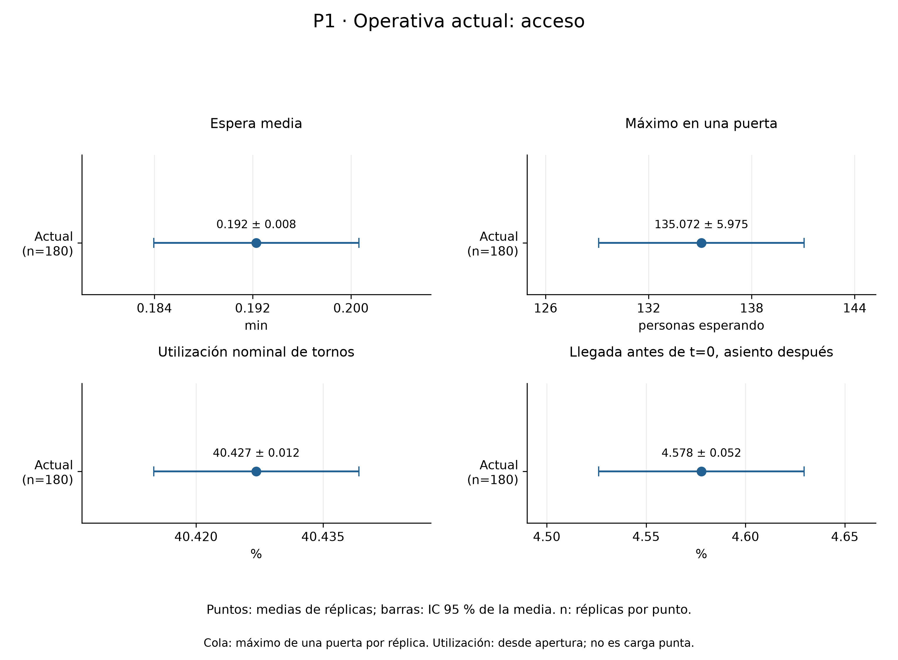
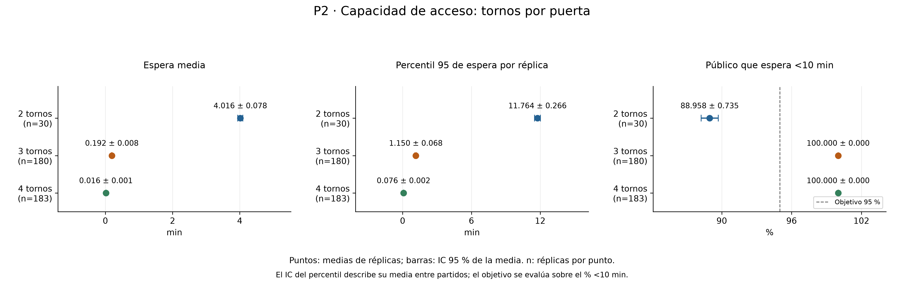
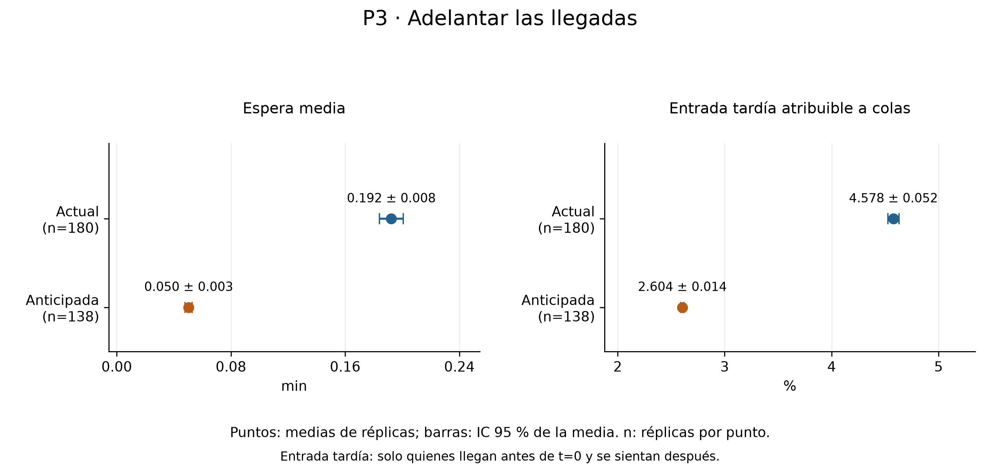
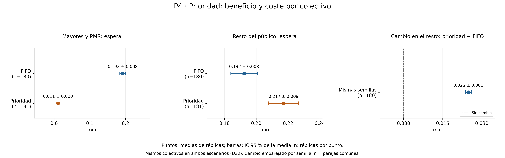
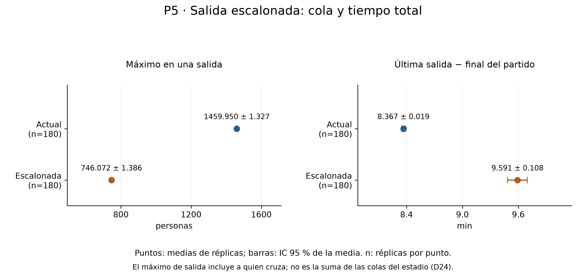
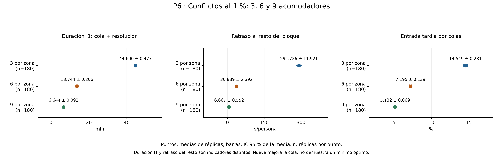
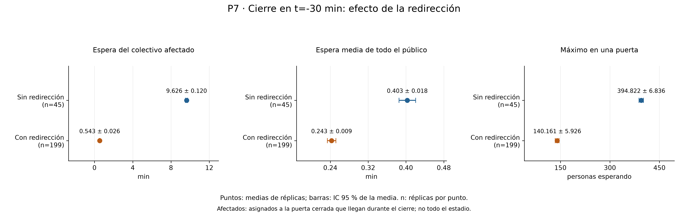
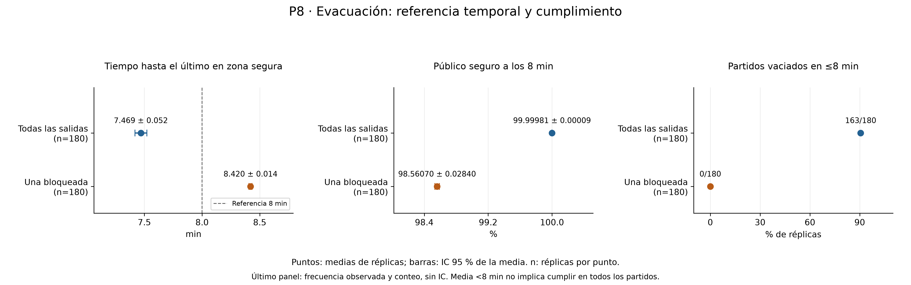
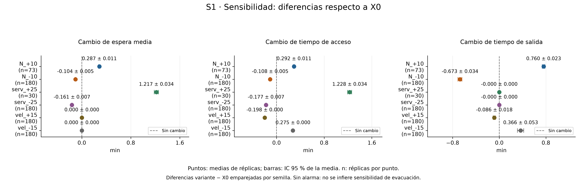

# T6.1 · Gráficas de resultados P1–P8

Datos: 2.965 réplicas definitivas de T5.3, 19 escenarios; ver
[RESULTADOS_T5.3.md](RESULTADOS_T5.3.md). No se han ejecutado nuevas simulaciones.

## Reproducción y lectura

Desde la raíz del clon, con el entorno instalado:

```bash
.venv/bin/python scripts/plot_results.py
# Con el entorno activado, también en Windows:
python scripts/plot_results.py --data results/final --output results/figures
```

Cada punto es una media entre réplicas y cada barra un IC t-Student del 95 %
de esa media. `n` indica observaciones válidas por punto. La frecuencia de
partidos que cumplen el plazo en P8 se presenta como conteo, sin IC.
Los percentiles dibujados son medias de percentiles por partido, no un percentil
calculado juntando todos los espectadores de todas las réplicas.

Los ejes horizontales tienen escalas propias y pueden estar ampliados;
comparar sus valores, no las longitudes entre paneles. Los tamaños por escenario
son distintos. Los contrastes de P4 y S1 se calculan emparejando semillas comunes,
no restando las medias de muestras de tamaños diferentes. Los demás paneles
presentan las medias de cada escenario; los IC de diferencias están en T5.3.
La precisión objetivo del 5 % se verificó para la espera media, no para cada KPI.

Formatos: PNG a 300 dpi para visualizar y SVG vectorial para insertar/escalar.
[statistics.csv](../results/figures/statistics.csv) conserva por punto la fuente,
KPI, escenario, emparejamiento, unidad, n, media, semianchura y conteo si procede.
[manifest.json](../results/figures/manifest.json) registra hashes SHA-256 de los
archivos de entrada, script y salidas, versión matplotlib y commit del cálculo.
La exportación exige campaña completa, precisión verificada e identidades
consistentes en las tablas auxiliares. Los datos de `results/final` no se modifican.

## P1 · Operativa actual



Espera media, máximo de personas esperando en una puerta, utilización nominal
(convertida de fracción a %) y entrada tardía. La utilización se mide desde la
apertura; no describe la carga de la hora punta. Los agregados disponibles no
permiten reconstruir una serie de cola a lo largo del reloj. El contraste de
capacidad de P2 y la verificación T6.2 completan el análisis del cuello de botella.
[SVG](../results/figures/P1.svg).

## P2 · Tornos por puerta



Con dos tornos, el 88,96 % espera menos de diez minutos, por debajo del objetivo
95 %. Con tres y cuatro, las réplicas observadas dan 100 %. Tres es el menor
número ensayado que satisface el objetivo observado; no es una garantía para
cualquier partido real. [SVG](../results/figures/P2.svg).

## P3 · Anticipar la llegada



La espera media pasa de 0,192 a 0,050 min y la entrada tardía de 4,578 a 2,604 %.
Esta última considera solo personas que llegaron antes del inicio y se sentaron
después; incluye el recorrido hasta el asiento. [SVG](../results/figures/P3.svg).

## P4 · Prioridad



Se comparan los mismos colectivos en FIFO y prioridad, usando `groups.csv`
(D32). Mayores y PMR reducen su espera; el resto aumenta unos 0,025 min
(aproximadamente 1,5 s). El tercer panel muestra el cambio emparejado en el resto,
con 180 parejas, aunque prioridad tiene 181 réplicas. [SVG](../results/figures/P4.svg).

## P5 · Salida escalonada



El máximo en una salida baja de unas 1.460 a 746 personas, a cambio de prolongar
el vaciado desde el final del partido en unos 1,224 min (contraste emparejado T5.3).
El máximo incluye a quien está cruzando; no suma todas las colas (D24).
[SVG](../results/figures/P5.svg).

## P6 · Acomodadores y conflictos



Con 3/6/9 acomodadores por zona, la duración media I1 (cola + resolución) es
44,600/13,744/6,644 min. El segundo panel es otro indicador: diferencia de tiempo
vomitorio–asiento entre otros espectadores con/sin solape con I1 en su bloque,
excluyendo a los causantes (D25), en segundos por persona. No es el tiempo de
resolución ni una comparación individual contrafactual. Nueve reduce la cola;
no se ha demostrado que la elimine ni que sea el mínimo óptimo. Se mantienen
probabilidad 1 % y resolución Triangular(1,3,10) min (D33).
[SVG](../results/figures/P6.svg).

## P7 · Cierre de puerta



Cierre de A-1 durante [−30,−20) min (D31). El primer panel usa solo personas
asignadas a esa puerta que llegan durante el cierre: 9,626 min sin redirección
frente a 0,543 con ella. Los otros dos paneles describen el estadio completo.
No se modifica la hipótesis sobre personas que ya estaban en cola (D23).
[SVG](../results/figures/P7.svg).

## P8 · Evacuación



Tiempo medio: 7,469 min con todas las salidas, 8,420 con una bloqueada.
Aunque la primera media es inferior a ocho, solo 163/180 réplicas vacían por
completo en ese plazo; con bloqueo, 0/180. El porcentaje medio de personas seguras
a los ocho minutos es 99,99981 % y 98,56070 %, respectivamente. Se muestran más
decimales para evitar un redondeo engañoso a 100 %.
[SVG](../results/figures/P8.svg).

## S1 · Sensibilidad complementaria



Diferencias variante − X0 emparejadas por semilla para espera, acceso y salida.
Aumentar el tiempo de servicio tiene un efecto fuerte en la espera; la velocidad
modifica acceso y salida sin alterar la cola de tornos. Las variantes no tienen
alarma: no constituyen un análisis de sensibilidad de evacuación.
[SVG](../results/figures/S1.svg).

## Pendiente

T6.2: verificación/validación conjunta de A, B y C (carga con dos tornos, ritmo
por torno, capacidad y límites del modelo). No depende de fusionar estas figuras.
T6.3: incorporar resultados y figuras a la memoria, tras T6.1 y T6.2, justificando
X6 en −30, nueve acomodadores y los tamaños de muestra por precisión.
