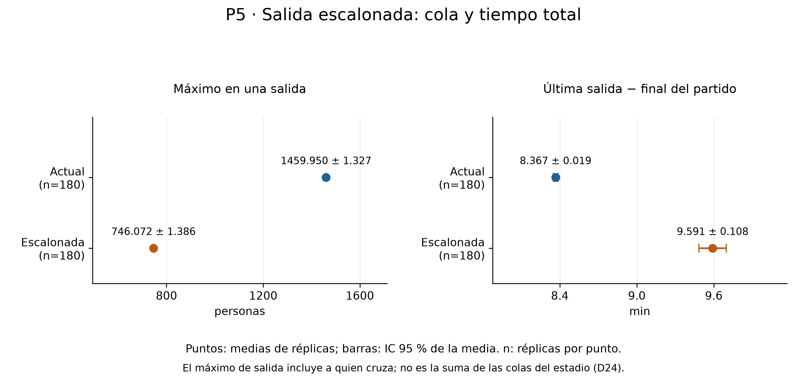
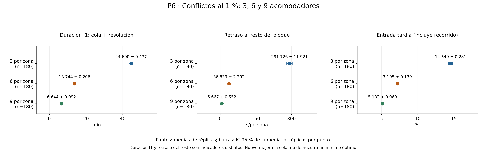
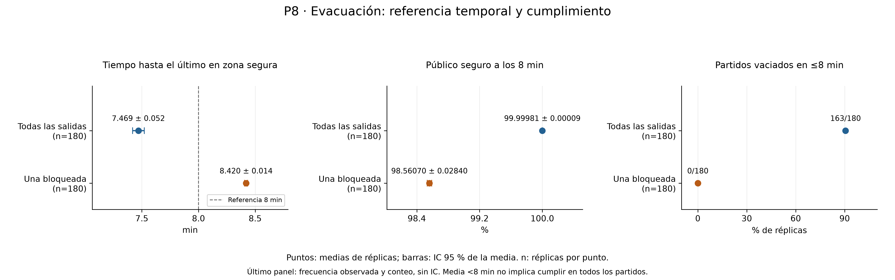

# B3: Respuestas a P5, P6 y P8

Autor: Pablo Pérez Molina (rol B). Texto final para la memoria de la Parte 2. P7, el cierre de puerta, se responde en A3. Las figuras son las de results/figures; en la memoria en Word conviene usar los PNG.

## Respuestas

Los resultados proceden de las réplicas definitivas: 180 por escenario. Se da la
media de las réplicas y, entre paréntesis, la semianchura del intervalo de
confianza del 95 %.

### P5. ¿Reduce las colas en las salidas que la grada superior salga más tarde?

Sí. Con la salida escalonada, la cola máxima en una salida baja de 1.460 (1,3)
a 746 (1,4) personas, casi la mitad: 714 personas menos (0,6), en diferencia
emparejada. A cambio, el estadio tarda en vaciarse 9,59 min (0,11) en lugar de
8,37 min (0,02): 1,22 min más (0,11). La salida escalonada reparte la carga en el tiempo
y conviene si lo que preocupa es la aglomeración en las salidas, no el tiempo
total de vaciado.

### P6. ¿Cuánto retrasan los conflictos por asiento y cuántos acomodadores hacen falta?

Con conflictos al 1 % hay unos 490 conflictos por partido, unos 122 por
macrozona, concentrados en la hora punta. Cada uno ocupa a un acomodador una
media de 4,67 min, así que el número de acomodadores es decisivo:

| Acomodadores por macrozona | Duración media de un conflicto | Retraso al resto del bloque | Entrada tardía |
| --- | --- | --- | --- |
| 3 | 44,60 min (0,48) | 291,7 s por persona (11,9) | 14,55 % (0,28) |
| 6 | 13,74 min (0,21) | 36,8 s por persona (2,4) | 7,20 % (0,14) |
| 9 | 6,64 min (0,09) | 6,7 s por persona (0,6) | 5,13 % (0,07) |

Cada nivel tiene 180 réplicas, con los mismos conflictos en las tres variantes.

Con 3 acomodadores el sistema se satura: los conflictos esperan mucho más de lo
que tardan en resolverse y, en el peor caso observado, el último espectador se
sienta casi tres horas después del inicio del partido. Con 6 todavía se forma
cola. De los tres niveles probados, solo con 9 la duración de un conflicto se
acerca a la de la propia resolución.

### P8. ¿Se evacúa el estadio en menos de 8 min? ¿Y con una salida bloqueada?

Con todas las salidas, el vaciado dura de media 7,47 min (0,05) y se cumple el
límite de 8 min en 163 de las 180 réplicas. En las 17 restantes solo llega tarde
una persona de movilidad reducida que camina despacio y está lejos de la salida:
la capacidad de las salidas sí basta, y el riesgo está en evacuar a tiempo a las
personas con movilidad reducida.

Con una salida bloqueada, el vaciado dura de media 8,42 min (0,01) y no se cumple
el límite en ninguna réplica. En este caso sí falla la capacidad: las 5 salidas
restantes no dan abasto. Aun así, a los 8 min ya está a salvo el 98,56 % (0,03)
de las personas que evacúan.

Estos tiempos son mayores que los 5,9 y 7,1 min de la validación porque incluyen
el tiempo de reacción y la marcha hasta la salida, que la validación excluía a
propósito para medir solo el paso por las salidas.

