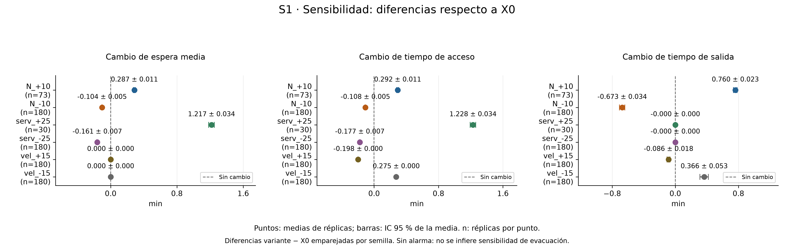

# C2. Sensibilidad de los resultados

## 1. Diseño de S1

Se estudian seis variantes respecto a X0, modificando un solo factor por variante:
aforo ±10 %, velocidad de marcha ±15 % o tiempo de servicio ±25 %. Los demás
parámetros mantienen la configuración base, con salida ordinaria y sin alarma.
Las variaciones no tienen el mismo tamaño porcentual entre factores; por tanto,
las diferencias observadas no son una clasificación universal de su importancia.
Tampoco se exploran combinaciones simultáneas de factores.

La tabla muestra diferencias emparejadas variante menos X0, con IC nominal del
95 %. Todos los tiempos están en minutos. n cuenta semillas comunes; los tamaños
totales pueden ser mayores, como se explica en C1.

| Variante | n parejas | Cambio de espera media | Cambio de acceso | Cambio de vaciado ordinario |
|---|---:|---:|---:|---:|
| Aforo -10 % | 180 | -0,1036 ± 0,0050 | -0,1085 ± 0,0051 | -0,6734 ± 0,0342 |
| Aforo +10 % | 73 | +0,2867 ± 0,0114 | +0,2924 ± 0,0112 | +0,7604 ± 0,0228 |
| Velocidad -15 % | 180 | 0 | +0,2748 ± 0,0001 | +0,3658 ± 0,0532 |
| Velocidad +15 % | 180 | 0 | -0,1983 ± 0,0001 | -0,0861 ± 0,0182 |
| Servicio -25 % | 180 | -0,1613 ± 0,0069 | -0,1772 ± 0,0069 | ≈0 |
| Servicio +25 % | 30 | +1,2172 ± 0,0341 | +1,2283 ± 0,0339 | ≈0 |

En velocidad, la espera de tornos es idéntica semilla a semilla y su diferencia
tiene IC [0,0]. Los cambios de vaciado al modificar el servicio son del orden
del redondeo numérico, no mejoras operativas. Las cifras exactas, sin el redondeo
de la tabla, están en `results/final/comparisons.csv`.

## 2. Interpretación por factor

**Aforo.** Una reducción del 10 % disminuye la espera media unos 0,104 min; un
aumento del 10 % la incrementa unos 0,287 min. El efecto no es simétrico: el
escenario base ya se aproxima a la capacidad de entrada en la franja más cargada.
La misma variación relativa de demanda puede provocar un aumento de cola mayor
que la reducción que produce el cambio contrario. También cambia el vaciado,
porque deben atravesar las salidas más o menos personas.

**Servicio.** Al aumentar el tiempo de control un 25 %, la espera media crece
unos 1,217 min, aproximadamente 73 s, frente a una base de 0,192 min. Al reducirlo,
la mejora es de unos 0,161 min y queda poco margen adicional, porque la espera
no puede ser negativa. La respuesta a P2 es, por tanto, sensible al tiempo de
servicio supuesto; el resultado con tres tornos corresponde a los parámetros
ensayados. En estas variantes el vaciado ordinario apenas cambia, porque la
entrada termina antes del final del partido y se mantienen demanda, recorrido y
capacidad de salida.

**Velocidad.** No cambia la cola de entrada: la marcha se realiza después del
control y el modelo no devuelve bloqueos del interior hacia el torno. Sí cambia
el tiempo de acceso y el de salida, que incluyen desplazamientos. La lentitud
aumenta el acceso unos 0,275 min, mientras el aumento de velocidad lo reduce
unos 0,198 min. Esto es coherente con que el tiempo de recorrido depende del
inverso de la velocidad.

## 3. Alcance de la comprobación

S1 permite valorar si algunas conclusiones dependen mucho de los parámetros
inciertos ensayados. No proporciona una calibración con observaciones reales,
ni demuestra robustez frente a cualquier cambio. Los IC pequeños solo indican
poca incertidumbre muestral bajo las hipótesis del modelo; no eliminan la
incertidumbre de esas hipótesis.

Estas variantes no tienen alarma. No se deben presentar como una sensibilidad
de evacuación: la observación de B sobre personas con movilidad reducida en P8
procede de las comprobaciones específicas de X7. Tampoco se ha ensayado aquí un
aforo y un servicio mayores a la vez, ni un plan de ayuda durante una emergencia.

Fuentes: `results/final/comparisons.csv`, `results/final/kpis.csv`,
configuraciones resueltas de `results/final/manifest.json` y figura S1 de T6.1.
